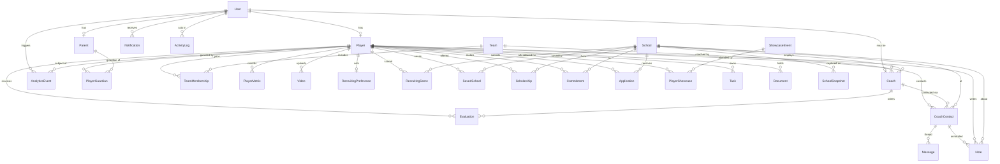

# ER Diagram

Rendered from the Prisma schema. Crow's-foot: `||` one, `o{` many, `o|` optional-one.

## Grouping

- **Identity**: User, Player, Parent, PlayerGuardian, Coach
- **Organizations**: School, SchoolSnapshot, Team, TeamMembership
- **Player data**: PlayerMetric, Video, Evaluation
- **Recruiting**: RecruitingScore, RecruitingPreference, SavedSchool, CoachContact,
  Message, Scholarship, Commitment, Application
- **Events**: ShowcaseEvent, PlayerShowcase
- **Ops**: Task, Notification, Document, Note, AnalyticsEvent, ActivityLog
